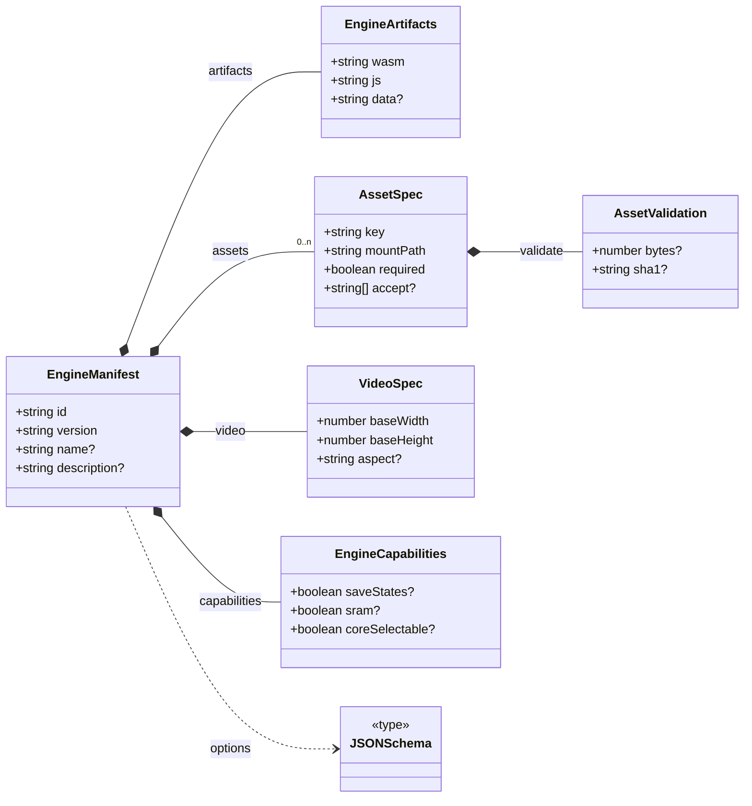
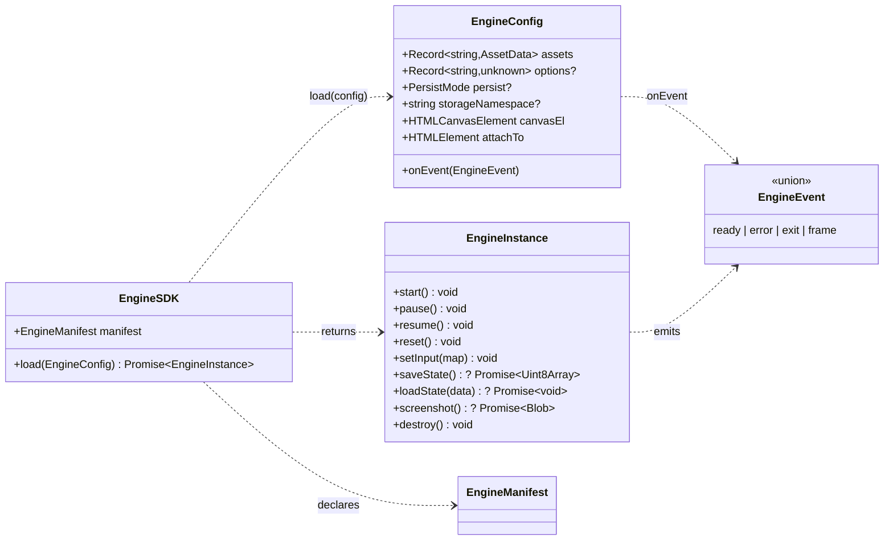

# Contract map

How the contract's types fit together. The interfaces barely inherit from each other —
they *contain* each other, which is why the generated **Hierarchy** page is empty and this
one exists.

## Layer A — the manifest

What an engine declares about itself, before anything boots. Every box is a type you can
open: {@link EngineManifest}, {@link AssetSpec}, {@link EngineCapabilities}.

## Layer B — driving the engine

The host holds an {@link EngineSDK}, calls `load()` with an {@link EngineConfig}, and gets
back an {@link EngineInstance}. Events flow the other way, through `onEvent`.

The capability-gated members (`saveState`, `loadState`, `screenshot`) exist **only** when
{@link EngineCapabilities} says so — that dashed line between the two layers is the whole
point of splitting them.
