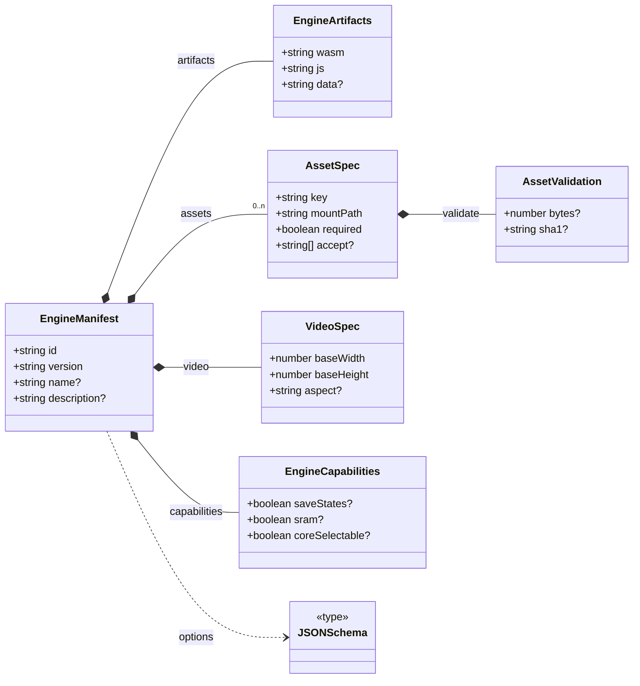
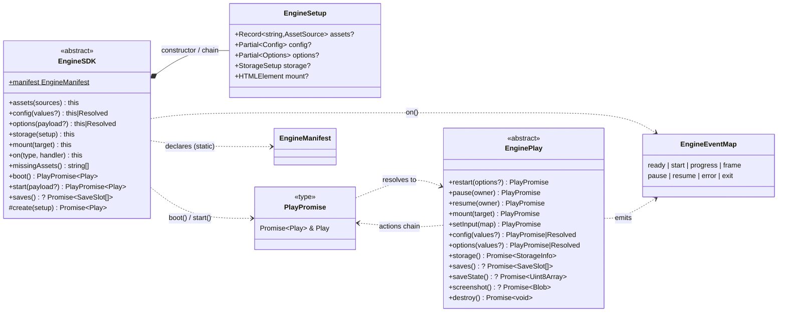

# Contract map

How the contract's types fit together. The interfaces barely inherit from each other —
they *contain* each other, which is why the generated **Hierarchy** page is empty and this
one exists.

## Layer A — the manifest

What an engine declares about itself, before anything boots. Every box is a type you can
open: {@link EngineManifest}, {@link AssetSpec}, {@link EngineCapabilities}.



## Layer B — driving the engine

Two classes. The host configures an {@link EngineSDK} by chaining — all synchronous, none
of it crosses to the engine — and `boot()`/`start()` hand back an {@link EnginePlay}: the
live engine. Sessions come and go on that same engine through `restart()`.



Three boot verbs, and two are sugar for the third — the equivalence is literal, it is how
the base class implements them:

| | what it does | equals |
| --- | --- | --- |
| `sdk.boot()` | engine alive, no session | — |
| `play.restart(p)` | opens or reopens a session | — |
| `sdk.start(p)` | engine alive **and** session running | `boot().restart(p)` |

`boot()` is idempotent, so one factory governs at most one live engine.

{@link PlayPromise} is what makes the chain work: a promise of the live engine hydrated
with the engine's own methods. Since every {@link EnginePlay} method already returns a
promise, actions come back chainable and queries come back closed, with no extra
machinery — and `then()` closes the chain, like a getter.

```js
await play.pause(OWNER.menu).options({ spindash: true }).resume(OWNER.menu)
const slots = await play.pause(OWNER.menu).saves()   // closes
```

`destroy()` closes too, returning `Promise<void>`. That `await` is the barrier that keeps
the factory frozen until teardown settles — without it a host could repoint `storage()`
while the old engine is still flushing saves into the old namespace.

The capability-gated members (`saves`, `deleteSave`, `saveState`, `loadState`,
`screenshot`) exist **only** when {@link EngineCapabilities} says so — that dashed line
between the two layers is the whole point of splitting them.
